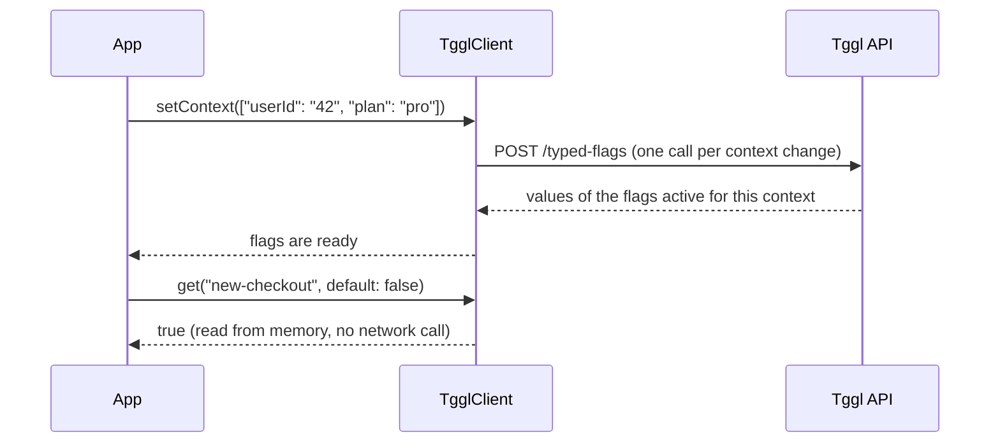

<div align="center">

# Tggl Swift Client

**Feature flags for iOS and macOS apps, powered by [Tggl](https://tggl.io).**


</div>

```swift
if tggl.get("new-checkout", default: false) {
    showNewCheckout()
}
```

---

## Contents

- [Why this client](#why-this-client)
- [How it works](#how-it-works)
- [Installation](#installation)
- [Setup](#setup)
- [Usage](#usage)
  - [Reading flags](#reading-flags)
  - [Managing the context](#managing-the-context)
  - [SwiftUI](#swiftui)
  - [UIKit and Combine](#uikit-and-combine)
  - [Waiting for flags](#waiting-for-flags)
  - [Keeping flags up to date](#keeping-flags-up-to-date)
  - [Handling errors](#handling-errors)
  - [Previews and tests](#previews-and-tests)
- [Configuration](#configuration)
- [API reference](#api-reference)

---

## Why this client

| | |
|---|---|
| ⚡️ **Synchronous, typed reads** | `get("flag", default: false)` returns a `Bool`, from any thread, with no `await`. |
| 🛡 **Safe by default** | Inactive, deleted or unknown flags, type mismatches and network errors all return your default value. |
| 🎨 **SwiftUI ready** | `TgglClient` is an `ObservableObject`: views re-render when flags change. |
| 📡 **Reactive** | Combine publishers emit the current value, then each change, including when a flag is switched off. |
| 📴 **Offline first** | The last flags are cached and used at the next launch, before the network answers. |
| 🔁 **Resilient** | Retries with backoff, Tggl Proxy support, automatic fallback to the Tggl API. |
| 📊 **Usage stats** | Evaluations are batched and reported to your Tggl dashboard. |

## How it works

The client uses [remote evaluation](https://tggl.io/developers/evaluating-flags/remote-evaluation): your rules stay on Tggl's side, the app only receives results.



**One rule to remember: Tggl only returns the flags that are active for the context.** Whenever a flag can't be evaluated, `get` returns the default value you pass. That happens when the flag is:

- inactive for this user, archived or deleted;
- not loaded yet (first launch, before the first response);
- of another type than your default;
- unreachable because of a network error.

👉 Always pick the default that keeps your app safe, usually the "old" behavior.

## Installation

### Xcode

1. **File › Add Package Dependencies…**
2. Paste `https://github.com/Tggl/swift-tggl-client`
3. Choose **Up to Next Major Version** from `2.0.0` and add the **TgglClient** library to your app target.

### Package.swift

```swift
dependencies: [
    .package(url: "https://github.com/Tggl/swift-tggl-client", from: "2.0.0")
],
targets: [
    .target(name: "MyApp", dependencies: [
        .product(name: "TgglClient", package: "swift-tggl-client")
    ])
]
```

**Requirements:** iOS 16+ or macOS 14+, Swift 5.9+ (Xcode 15+).

## Setup

### 1. Get a client API key

In the Tggl dashboard, open **[API keys](https://app.tggl.io/project/default/api-keys)** and copy the **client** key.

> [!WARNING]
> Only ship the **client** key in an app. The server key gives access to your whole flag configuration and must never leave your backend.

### 2. Create one client for the whole app

Create a single `TgglClient` when the app starts and share it. It starts fetching flags right away.

**SwiftUI**

```swift
import SwiftUI
import TgglClient

@main
struct MyApp: App {
    @StateObject private var tggl = TgglClient(apiKey: "YOUR_CLIENT_API_KEY")

    var body: some Scene {
        WindowGroup {
            ContentView()
                .environmentObject(tggl)
        }
    }
}
```

**UIKit, or any shared service**

```swift
import TgglClient

enum FeatureFlags {
    static let client = TgglClient(
        apiKey: "YOUR_CLIENT_API_KEY",
        options: TgglOptions(appName: "MyApp")
    )
}
```

### 3. Tell Tggl who the user is

Send the context as soon as you know the user. Each property can then be used in your flag rules (percentage rollouts, segments, plans…).

```swift
func didLogIn(_ user: User) async {
    await tggl.setContext([
        "userId": user.id,
        "email": user.email,      // String? — nil is sent as null
        "plan": user.plan.rawValue,
        "country": user.country,
        "appVersion": Bundle.main.infoDictionary?["CFBundleShortVersionString"] as? String,
    ])
}

func didLogOut() async {
    await tggl.setContext([:])
}
```

That's it, you can now read flags anywhere. 🎉

## Usage

### Reading flags

The **type of the default** decides the expected type of the flag:

```swift
let enabled  = tggl.get("new-checkout", default: false)         // Bool
let variant  = tggl.get("onboarding-variant", default: "control") // String
let maxItems = tggl.get("cart-max-items", default: 10)           // Int (exact integers only)
let ratio    = tggl.get("discount-ratio", default: 0.0)          // Double
let tags     = tggl.get("home-sections", default: [String]())    // [String]
```

#### Feature toggle

```swift
if tggl.get("new-checkout", default: false) {
    NewCheckoutFlow().start()
} else {
    LegacyCheckoutFlow().start()
}
```

#### A/B test

```swift
switch tggl.get("paywall-variant", default: "control") {
case "annual-first": showPaywall(highlight: .annual)
case "trial":        showPaywall(highlight: .trial)
default:             showPaywall(highlight: .monthly)
}
```

#### Remote configuration with JSON flags

```swift
struct Banner: Codable {
    let title: String
    let message: String
    let color: String
}

let banner = tggl.decode(
    "home-banner",
    as: Banner.self,
    default: Banner(title: "Welcome", message: "", color: "#000000")
)
```

#### Null values

A flag can be active with a `null` value. Use an optional default to tell it apart:

```swift
let coupon = tggl.get("promo-coupon", default: Optional("WELCOME10"))
// "WELCOME10" → flag inactive or unknown
// nil         → flag active with a null value
// "SUMMER25"  → flag active with this value
```

#### Kill switch

Default to the **safe** behavior, so that the feature stays off if Tggl can't be reached:

```swift
guard !tggl.get("disable-video-upload", default: false) else {
    return showMaintenanceMessage()
}
```

### Managing the context

```swift
// Replace the whole context
await tggl.setContext(["userId": "42", "plan": "free"])

// Merge a few keys, keeping the others
await tggl.updateContext(["plan": "pro"])

// Read it back
let context = tggl.context   // ["userId": "42", "plan": "pro"]
```

- Each change triggers **one** network call. The method returns once the new flags are applied (or the call failed).
- If the context changes several times quickly, only the response for the **latest** context is applied.
- Values can be `String`, `Int`, `Double`, `Bool`, arrays, dictionaries, `TgglValue` or `nil`.

### SwiftUI

Views that read the client re-render automatically when flags change:

```swift
struct HomeView: View {
    @EnvironmentObject private var tggl: TgglClient

    var body: some View {
        VStack {
            if tggl.get("show-stories", default: false) {
                StoriesCarousel()
            }
            Feed()
        }
        .navigationTitle(tggl.get("home-title", default: "Home"))
    }
}
```

Updating the context from a view:

```swift
.task(id: session.user?.id) {
    if let user = session.user {
        await tggl.setContext(["userId": user.id, "plan": user.plan])
    } else {
        await tggl.setContext([:])
    }
}
```

### UIKit and Combine

`publisher(for:default:)` emits the current value, then each change, on the main thread:

```swift
import Combine

final class CheckoutViewController: UIViewController {
    private var cancellables = Set<AnyCancellable>()

    override func viewDidLoad() {
        super.viewDidLoad()

        FeatureFlags.client.publisher(for: "express-checkout", default: false)
            .sink { [weak self] enabled in
                self?.expressButton.isHidden = !enabled
            }
            .store(in: &cancellables)
    }
}
```

> [!NOTE]
> When a flag is switched off in Tggl, it disappears from the evaluation and the publisher emits the **default value**. Your UI goes back to the safe state on its own.

Other publishers: `flagsPublisher` (all flags), `isReadyPublisher` and `errorPublisher`.

### Waiting for flags

The client is **ready** after the first response, even a failed one. It is ready immediately when flags were cached by a previous launch for the same context. Before that, `get` returns defaults.

Hold the splash screen until flags are known, with a timeout so a slow network never blocks the user:

```swift
struct RootView: View {
    @EnvironmentObject private var tggl: TgglClient
    @State private var isLoading = true

    var body: some View {
        Group {
            if isLoading { SplashView() } else { MainView() }
        }
        .task {
            await withTaskGroup(of: Void.self) { group in
                group.addTask { await tggl.waitReady() }
                group.addTask { try? await Task.sleep(nanoseconds: 2_000_000_000) }
                await group.next()
                group.cancelAll()
            }
            isLoading = false
        }
    }
}
```

You can also check `tggl.isReady` synchronously.

### Keeping flags up to date

Tggl does not push changes to apps. To pick up a change without a context change, refresh or poll:

```swift
await tggl.refetch()                 // one-off refresh, e.g. on pull-to-refresh

tggl.startPolling(every: 60)         // every minute
tggl.stopPolling()

// or at creation
TgglClient(apiKey: "…", options: TgglOptions(pollingInterval: 60))
```

On iOS, polling pauses while the app is in background and refreshes as soon as it comes back.

### Handling errors

Reading flags never throws: on failure the client keeps the last known flags (or defaults). Errors are there for monitoring:

```swift
if let error = tggl.lastError {          // cleared after the next successful call
    logger.warning("\(error.localizedDescription)")
}

tggl.errorPublisher
    .sink { error in Analytics.track("tggl_error", ["error": "\(error)"]) }
    .store(in: &cancellables)
```

| `TgglError` | Cause | Behavior |
|---|---|---|
| `.invalidApiKey` | 401 | Not retried, other URLs not tried |
| `.badRequest` | 400 | Not retried, other URLs not tried |
| `.httpStatus(code)` | 408, 429, 5xx | Retried with backoff, then next URL |
| `.httpStatus(code)` | Other status | Next URL |
| `.network(URLError)` | Offline, timeout, DNS… | Retried with backoff, then next URL |
| `.invalidResponse` | Unreadable body | Next URL |

### Previews and tests

Set flags locally, without any network call:

```swift
#Preview {
    let tggl = TgglClient(
        apiKey: "",
        options: TgglOptions(initialFetch: false, reporting: false, cache: .disabled)
    )
    tggl.setFlags(["show-stories": true, "home-title": "Preview"])

    return HomeView().environmentObject(tggl)
}
```

In unit tests, inject a `URLSession` with a mock `URLProtocol` through `TgglOptions(session:)`, and call `await tggl.close()` at the end of each test.

## Configuration

Every option has a sensible default:

```swift
let tggl = TgglClient(
    apiKey: "YOUR_CLIENT_API_KEY",
    context: ["userId": "42"],
    options: TgglOptions(
        baseUrls: [URL(string: "https://tggl-proxy.example.com")!],
        fallbackToTgglApi: true,
        maxRetries: 3,
        timeout: 8,
        initialFetch: true,
        pollingInterval: nil,
        reporting: true,
        reportingInterval: 5,
        appName: "MyApp",
        cache: .userDefaults,
        session: .shared
    )
)
```

| Option | Default | Description |
|---|---|---|
| `baseUrls` | `[]` | Tggl Proxy URLs, tried in order, each with its own retries. |
| `fallbackToTgglApi` | `true` | Append `https://api.tggl.io` as last resort. Set `false` if contexts must never leave your infrastructure. |
| `maxRetries` | `3` | Retries per URL, backoff 100 ms → 500 ms. |
| `timeout` | `8` | Timeout of each request, in seconds. |
| `initialFetch` | `true` | Fetch flags as soon as the client is created. |
| `pollingInterval` | `nil` | Polling interval in seconds, `nil` to disable. |
| `reporting` | `true` | Send evaluation stats to the Tggl dashboard. |
| `reportingInterval` | `5` | Seconds between two reporting batches. |
| `appName` | `nil` | Shown in the dashboard, e.g. `swift-client:2.0.0/TgglClient/MyApp`. |
| `cache` | `.userDefaults` | `.userDefaults`, `.disabled` or `.custom(TgglStorage)`. |
| `session` | `.shared` | `URLSession` used for all calls. |

### Cache

The last context and its flags are stored per API key and reused at the next launch **only for the same context**, so a new user never sees the previous user's flags.

> [!IMPORTANT]
> The context may contain personal data (email, ids…). The default storage is `UserDefaults`, which is not encrypted. If needed, provide your own storage, e.g. backed by the Keychain:

```swift
final class KeychainStorage: TgglStorage {
    func load() -> Data? { Keychain.read("tggl-cache") }
    func save(_ data: Data) { Keychain.write("tggl-cache", data) }
}

TgglOptions(cache: .custom(KeychainStorage()))
```

### Tggl Proxy

```swift
TgglOptions(baseUrls: [
    URL(string: "https://tggl-proxy-1.example.com")!,
    URL(string: "https://tggl-proxy-2.example.com")!,
])
// → proxy-1, then proxy-2, then https://api.tggl.io
```

### Reporting

Each evaluation is counted and sent in batches to feed the usage stats of your dashboard. Counts are kept if the network fails, and flushed when the app goes to background or when the client is closed.

```swift
await tggl.flushReporting()   // send now
await tggl.close()            // stop everything and send the last batch
```

## API reference

| Member | Description |
|---|---|
| `init(apiKey:context:options:)` | Creates the client and starts fetching flags. |
| `get(_:default:) -> T` | Typed value of a flag, or the default. Synchronous. |
| `decode(_:as:default:) -> T` | Decodes a JSON flag into a `Decodable` type. |
| `flags` | All active flags, `[String: TgglValue]`. |
| `context` | Current context. |
| `setContext(_:) async` | Replaces the context and re-evaluates flags. |
| `updateContext(_:) async` | Merges keys into the context and re-evaluates flags. |
| `refetch() async` | Re-evaluates flags for the current context. |
| `startPolling(every:)` / `stopPolling()` / `isPolling` | Periodic refresh. |
| `isReady` / `waitReady() async` | Whether flags are known. |
| `lastError` | Error of the last call, `nil` after a success. |
| `publisher(for:default:)` | Typed value of a flag, then each change. |
| `flagsPublisher` / `isReadyPublisher` / `errorPublisher` | Other Combine publishers. |
| `setFlags(_:)` | Local flags for previews, tests or offline mode (main actor). |
| `flushReporting() async` | Sends pending evaluation stats now. |
| `close() async` | Stops polling and network calls, sends the last stats. |

## Resources

- [Tggl developer documentation](https://tggl.io/developers)
- [Remote evaluation](https://tggl.io/developers/evaluating-flags/remote-evaluation)
- [Tggl Proxy](https://tggl.io/developers/evaluating-flags/tggl-proxy)
- [API reference](https://tggl.io/developers/api-reference)
- [Report an issue](https://github.com/Tggl/swift-tggl-client/issues)
